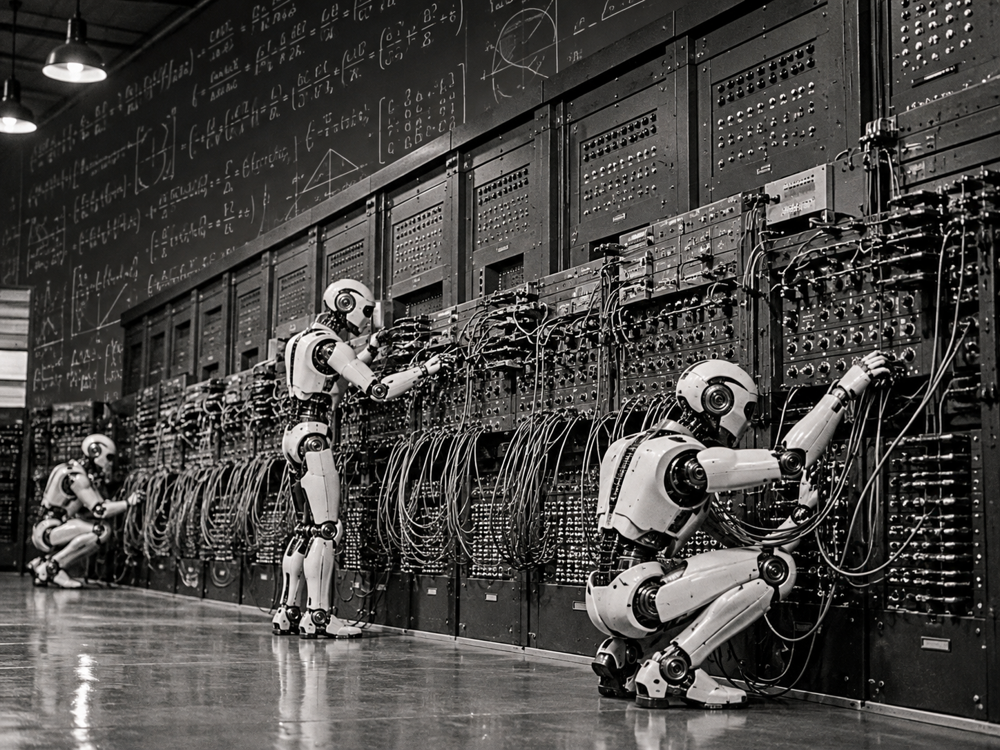

# I Spent My Life Learning to Write Code. Now I'm Learning When Not To.

*AI, the history of programming, and what it means to be a developer in the next era of computing.*

I've been thinking a lot about the future of software development. For most of my life, I've been a programmer. Writing code, debugging systems, understanding how things work, and solving problems have always been more than just a job to me. I love programming. I love the Linux terminal. I love discovering why something isn't working and the satisfaction of finally solving a complicated technical problem.

And now, with AI becoming increasingly capable of writing software, I sometimes find myself wondering: **am I watching the profession I've dedicated my life to become obsolete?**

{/* truncate */}

It's a strange feeling. I know how much AI can accomplish because I'm using it myself. I'm building things faster, experimenting more, and spending less time writing code. I'm excited about the possibilities. But there's also something uncomfortable about watching a machine perform work that took me years to master.

The more I think about it, however, the more I realize we've been through transformations like this before. Perhaps we're looking at this one from the wrong perspective.

## We used to program computers with cables

In the 1940s, programming computers such as ENIAC involved physically connecting cables and configuring switches. Imagine that. Changing a program could mean physically reconfiguring the machine.

Then came stored-program computers and assembly languages. Instead of manually configuring hardware, programmers could write symbolic instructions representing machine operations. That was a revolutionary abstraction.

Then came higher-level programming languages and compilers. Programmers no longer had to express everything in terms of registers, memory addresses, and machine instructions. They could describe algorithms using languages such as FORTRAN and, later, C.

Did compilers kill programmers? No. They changed what programmers needed to know. Assembly didn't disappear. It became a more specialized skill. And programmers who understood the underlying hardware often retained an advantage when performance, reliability, or unusual problems required deeper knowledge.

Then came more languages, managed runtimes, garbage collection, frameworks, and increasingly sophisticated development tools. Each new abstraction allowed more people to create software without mastering every layer beneath it. Some skills became less common. Some kinds of work disappeared. Entirely new specialties emerged. And the number of things we could accomplish with computers expanded enormously.

**We didn't stop programming. We changed how we programmed.**

## Understanding what's underneath still matters

I remember one of my early jobs when I encountered a serious performance problem involving string concatenation. The code looked perfectly reasonable. But under the hood, repeated concatenation was creating new strings, copying memory, and leaving old objects to be reclaimed. What appeared to be a simple operation became increasingly expensive.

The solution wasn't particularly complicated once I understood what was actually happening. The important part wasn't knowing the syntax. It was understanding the system. And that's something I've carried throughout my career.

**An abstraction can hide complexity, but it doesn't eliminate it.**

A programmer doesn't necessarily need to understand every layer of a computer. But knowing what's underneath can make a tremendous difference when something doesn't work as expected. Today, a developer can build an entire application without knowing much about memory allocation, CPU architecture, operating system internals, or networking. And that's an incredible achievement. But when something goes wrong, that deeper understanding can be the difference between applying another workaround and actually solving the problem.

I believe the same will be true with AI. AI can generate code, but will it be efficient? Secure? Scalable? Maintainable? Will it behave correctly under failure? Sometimes, yes. Sometimes, it will produce something that looks absolutely convincing and is fundamentally wrong.

Experience helps us recognize the difference. Not because experienced programmers are necessarily better at prompting AI, but because they have a deeper understanding of what a good solution should look like.

## Maybe AI is the next major abstraction

I see AI as something comparable to the transition from assembly language to high-level programming languages, although potentially much more disruptive. We are moving toward a world where describing *what we want* may become more important than specifying every detail of *how to implement it*.

That doesn't mean implementation becomes irrelevant. It means the interface between human intent and machine execution is changing again. Yesterday, we translated ideas into programming languages. Today, AI can increasingly perform that translation for us. Tomorrow, perhaps many people creating software won't know how to write traditional code at all.

And that's not necessarily a bad thing. We didn't stop creating software when compilers arrived. We created more software, for more people, solving problems that previously would have been too expensive or difficult to address.

But there's an important difference. A compiler translates instructions according to formally defined rules. AI interprets intent, makes decisions, and generates possible implementations. A compiler isn't expected to misunderstand what an addition operator means. AI, however, can misunderstand what we're trying to accomplish. It can also produce a technically correct implementation of a fundamentally incorrect idea. That makes this transition different from anything we've experienced before.

And it raises a question I don't think anyone can confidently answer yet: **will AI create more opportunities for programmers, as previous abstractions did, or will it eventually reduce the need for them?**

I don't know. Some programming jobs may disappear. Some skills will certainly become less valuable. And it's possible that AI will transform the employment landscape much more dramatically than previous technological changes.

But I don't believe the need to understand problems, design reliable systems, evaluate solutions, and make technical decisions will disappear simply because writing code becomes easier. The economics of software development may change completely. The complexity of the problems we're trying to solve will remain.

## The uncomfortable feeling of no longer writing the code

There's also a personal side to this transformation. I've spent years learning programming languages, understanding systems, improving my ability to solve problems, and discovering more efficient ways to build software. I've always enjoyed being hands-on. Even after moving into leadership roles, I never completely stopped being a developer.

So there's something strangely uncomfortable about asking AI to implement something I know I could write myself. Sometimes, it feels like I'm no longer doing the work.

But then I remember another transition in my career. When I became a CTO, I initially struggled with a similar feeling. I wasn't writing as much code anymore. Other people were implementing solutions while I spent more time discussing architecture, removing obstacles, making decisions, and helping teams move faster. At first, that didn't always feel productive. I was used to measuring my contribution by what I personally built. If I wasn't writing code, what exactly was I contributing?

Eventually, I realized that my experience had become useful in a different way. I could recognize problems before they happened. I could suggest an approach that avoided weeks of unnecessary work. I could see architectural consequences that weren't immediately obvious. I could help people make better decisions, not because I could type faster or knew more syntax, but because I'd already encountered similar problems.

**I wasn't solving fewer problems. I was solving them at a different level.**

And today, AI is bringing back that same feeling. Only this time, instead of guiding other developers, I'm often guiding an AI system. I describe the objective. I establish constraints. I review the proposed solution. I challenge decisions. I identify risks. Sometimes I change the entire approach. And the implementation can happen at a speed that would have been unimaginable just a few years ago.

I'm not always writing the code. But I'm still using everything I've learned about writing code. And I'm beginning to realize that perhaps I shouldn't measure my contribution by how much code I personally produce.

## "Talk is cheap. Show me the code."

There's a famous phrase in software development: **"Talk is cheap. Show me the code."** For years, that captured something fundamental about our profession. Ideas are easy. Making them work is difficult. Anyone can describe an application. Building one that actually works is another matter.

But what happens when AI can turn a description into working software? Does that make talking more valuable?

Not exactly. A vague idea is still a vague idea. An incomplete requirement still leads to an incomplete solution. And software that appears to work isn't necessarily software that works correctly, reliably, or safely.

What changes is the cost of producing an implementation. When writing code becomes dramatically cheaper, the ability to decide *what to build, why to build it, and whether the result is actually correct* becomes increasingly important. That's where experience continues to matter.

Knowing when to use a database instead of a cache. Understanding why a distributed system might fail. Recognizing a concurrency problem. Questioning an unnecessary dependency. Anticipating what happens when an external service becomes unavailable. These aren't merely syntax problems. They're engineering problems.

Of course, AI may eventually become increasingly capable of handling those decisions too. I don't think we should assume that today's limitations will remain permanent. But the ability to generate a solution and the responsibility for accepting that solution are two different things. Even when AI does the implementation, someone—or some accountable organization—must determine whether the system meets its objectives. And I think that distinction will become increasingly important.

## If AI writes the code, am I still programming?

This is the question I keep coming back to. If programming means typing instructions in a specific language, perhaps a substantial part of that work will eventually be automated. But is that really what programming means?

When I programmed in C, I didn't think about the individual machine instructions the compiler would generate. When I used a managed language, I didn't manually allocate and release every piece of memory. When I deployed an application using containers, I didn't personally configure every low-level operating system resource. I relied on abstractions. And I was still programming. Why should AI necessarily be different?

If I understand a problem, design an approach, establish constraints, guide an implementation, investigate its behavior, and verify that it works, am I no longer programming simply because I didn't type the source code? I don't think so.

Perhaps we're confusing the activity of writing code with the broader discipline of creating software. And perhaps AI will finally force us to separate the two. I may write fewer lines of code. I may spend more time explaining intentions, evaluating alternatives, reviewing architecture, and validating outcomes. But those activities have always been part of software engineering. The difference is that they may become a much larger part of the job.

And I have to admit something: I'm starting to enjoy it. Because the ideas don't stop coming. The problems don't stop being interesting. And now I can explore more solutions without spending days or weeks implementing every detail myself.

That doesn't mean I want to abandon the terminal or stop writing code. I still enjoy both. It simply means I'm discovering another way to use the knowledge I've accumulated.

## We might need to redefine what a programmer is

Perhaps one of the biggest mistakes we're making is assuming that programming means writing code. Writing code is one way of communicating instructions to a machine. It isn't the ultimate objective.

**The objective is solving problems.**

We've already moved from physically configuring hardware to machine instructions, assembly languages, high-level languages, frameworks, and increasingly sophisticated abstractions. Now we're beginning to express solutions through natural language.

That opens an enormous opportunity. People who previously couldn't create software may now be able to build useful applications. Experienced engineers may be able to spend less time on repetitive implementation and more time investigating difficult problems. Smaller teams may be able to accomplish what once required much larger organizations. And entirely new kinds of software may become practical to build.

None of this guarantees that the transition will be easy. It certainly doesn't guarantee that every programmer will keep their job. And it doesn't mean traditional programming knowledge will remain equally valuable in every context. But I find it difficult to believe that making software easier to produce will make human creativity, curiosity, technical understanding, and problem-solving irrelevant.

I don't know what the software development profession will look like in ten years. I don't know how many programmers companies will need, which languages we'll use, or how much software AI will eventually produce autonomously. And I won't pretend those uncertainties aren't concerning.

But I increasingly believe that my experience isn't simply becoming obsolete. It's becoming useful in a different way. I've already experienced that transformation once, when I moved from writing most of the code myself to helping other people build better systems. Now I'm experiencing it again. This time, the implementation is increasingly performed by AI.

Perhaps the future programmer won't be defined by how much code they write. Perhaps they'll be defined by how effectively they can turn an idea into a reliable, working system. And perhaps, after spending a lifetime learning how to tell computers *how* to do things, we're entering an era where we can spend more time thinking about *what* is worth doing.

**The syntax may change. The tools may change. Even the profession may change beyond recognition. But the problems still need to be solved.**

And that's the part of programming I've always loved most.
