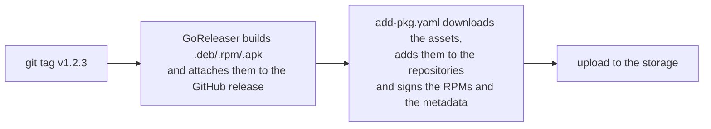

# Publishing Linux packages

ByJG hosts an APT repository at `https://packages.byjg.com/apt`, an RPM
repository at `https://packages.byjg.com/rpm` and an Alpine repository at
`https://packages.byjg.com/alpine`. The APT and RPM metadata and the RPM
packages are signed with the ByJG Opensource key, published as
`https://packages.byjg.com/byjg.gpg` (binary, for APT) and
`https://packages.byjg.com/byjg.asc` (armored, for RPM). apk does not use GPG:
the Alpine index is signed with the same key's RSA material, whose public half
is published as `https://packages.byjg.com/byjg.rsa.pub`. The repositories
and these public keys are served from `https://packages.byjg.com` (the private
keys never are: see [The signing key](#the-signing-key)).

How users install from them: [Package Repository](/docs/packages).

## How it works



The [`add-pkg.yaml`](https://github.com/byjg/byjg.github.io/blob/master/.github/workflows/add-pkg.yaml)
workflow does not build anything. It picks up the `*.deb`, `*.rpm` and `*.apk`
files attached to a GitHub release, so the project must build and attach them first.

## Build the packages

Use [GoReleaser](https://goreleaser.com) with an `nfpms` section. Trimmed
from `docker-static-httpserver/.goreleaser.yaml`:

```yaml
builds:
  - id: static-httpserver
    binary: static-httpserver
    env:
      - CGO_ENABLED=0
    goos:
      - linux
      - darwin        # archives only; packages are built for linux
    goarch:
      - amd64
      - arm64

nfpms:
  - id: static-httpserver-pkg
    package_name: static-httpserver
    ids:
      - static-httpserver
    vendor: ByJG
    homepage: https://github.com/byjg/docker-static-httpserver
    maintainer: ByJG <opensource@byjg.com>
    description: Minimal HTTP/HTTPS server for static files with SPA support
    license: MIT
    formats:
      - deb
      - rpm
      - apk
```

- Build at least **amd64 and arm64**. Other architectures are fine (nimbus
  also ships `armhf`, from `goarch: arm` + `goarm: "7"`): the APT `Release`
  declares whatever architectures the packages in the repository have.
- `package_name` is what users type in `apt install`. All ByJG packages share
  one repository, so it must be unique across projects.
- `apk` builds Alpine packages, for the Alpine repository. Build it only for a
  binary that runs on musl: a static Go binary (`CGO_ENABLED=0`) does; one linked
  against glibc (a Rust `-gnu` target, cgo) does not.

## Add the release workflow

`.github/workflows/release.yaml`:

```yaml
name: Release

on:
  push:
    tags:
      - "v*"

permissions:
  contents: write

jobs:
  release:
    runs-on: ubuntu-latest
    steps:
      - uses: actions/checkout@v7
        with:
          fetch-depth: 0

      - uses: actions/setup-go@v7
        with:
          go-version-file: go.mod

      - name: Run GoReleaser
        uses: goreleaser/goreleaser-action@v7
        with:
          version: latest
          args: release --clean
        env:
          GITHUB_TOKEN: ${{ secrets.GITHUB_TOKEN }}

  publish-packages:
    needs: release
    uses: byjg/byjg.github.io/.github/workflows/add-pkg.yaml@master
    with:
      org: byjg
      repo: docker-static-httpserver
      tag: ${{ github.ref_name }}
    secrets:
      DOC_TOKEN: ${{ secrets.DOC_TOKEN }}
      GPG_PRIVATE_KEY: ${{ secrets.GPG_PRIVATE_KEY }}
      R2_ACCOUNT_ID: ${{ secrets.R2_ACCOUNT_ID }}
      R2_ACCESS_KEY_ID: ${{ secrets.R2_ACCESS_KEY_ID }}
      R2_SECRET_ACCESS_KEY: ${{ secrets.R2_SECRET_ACCESS_KEY }}
      APK_PRIVATE_KEY: ${{ secrets.APK_PRIVATE_KEY }}
```

| Input | Meaning |
|---|---|
| `org` | Repository owner; defaults to `byjg` |
| `repo` | Repository whose release holds the packages |
| `tag` | Release tag to download from |
| `keep_versions` | How many versions of each package the repositories keep; defaults to `8` |

`publish-packages` **must** `needs: release`: the assets have to exist before
they can be downloaded. `APK_PRIVATE_KEY` is needed only when the release has
`.apk` assets: then the job fails without it.

## What the workflow does

1. Downloads the whole storage: the repositories are rebuilt from every
   package in them.
2. Imports `GPG_PRIVATE_KEY` and re-exports the public key to `byjg.gpg`
   (binary) and `byjg.asc` (armored).
3. Downloads the release's `*.deb`, `*.rpm` and `*.apk` assets.
4. **APT:** copies the `.deb` files into `apt/`, deletes the versions older
   than the last `keep_versions` of every package, regenerates
   `Packages`, `Packages.gz` and `Release` (its `Architectures:` line is taken
   from `Packages`), and signs them into `Release.gpg` and `InRelease`.
5. **RPM:** the same in `rpm/`; then signs every `.rpm`
   there with `rpmsign --addsign` (files already signed by the key are
   skipped), runs `createrepo_c --update`, and signs `repodata/repomd.xml`.
   The RPMs in the repository are signed; the ones attached to the GitHub
   release are not.
6. **Alpine:** in an Alpine container
   ([`apk-repo.sh`](https://github.com/byjg/byjg.github.io/blob/master/.github/scripts/apk-repo.sh)),
   copies each `.apk` to `alpine/<arch>/<name>-<version>.apk`, reading the
   name, version and architecture from the package, keeps the last
   `keep_versions`, then rebuilds `APKINDEX.tar.gz` and signs it with
   `APK_PRIVATE_KEY`. The packages are not signed: apk trusts them by the
   checksum the signed index has. It also writes `byjg.rsa.pub`.
7. Uploads the storage back in three passes: the new packages, then the index
   files with `Cache-Control: no-cache` (a stale `Packages.gz` from the
   Cloudflare cache next to a fresh `InRelease` makes apt fail with "Hash Sum
   mismatch"), and only then deletes the pruned packages.

## Rules

- **Never republish a version.** Files with the same name are overwritten in
  place. A change means a new tag.
- **Check the log when nothing appears.** A release without matching assets
  is not an error: the job logs `No .deb files found, skipping APT` and
  succeeds.
- **Only the last versions stay.** The repositories keep the last
  `keep_versions` (8) versions of each package, every architecture of a
  version together (`dpkg-scanpackages --multiversion`), so users can pin or
  roll back to one of them. Upgrading never needs the versions in between.
- **One release at a time.** Two projects publishing at the same moment both
  upload their copy of the storage, and the second one deletes what the first
  added. Re-run the first project's `publish-packages` job to put it back.

## Homebrew

Command-line tools are also published as Homebrew formulas in
[byjg/homebrew-tap](https://github.com/byjg/homebrew-tap), for macOS and
Linux. The formulas build from the source archive of a release tag, so no
macOS binaries, code signing or extra release job is needed.

- **Adding a tool:** add `Formula/<name>.rb` to the tap with a `test do`
  block. The tap README has the checks to run.
- **New versions:** nothing to do. A daily workflow in the tap finds newer
  release tags with `brew livecheck`, updates `url` and `sha256`, then builds,
  tests and audits the formula before committing it.

## The signing key

The repository metadata -- APT `Release`/`InRelease` and RPM
`repodata/repomd.xml` -- and every RPM package are signed with the ByJG
Opensource key. The RPM setup uses `gpgcheck=1` (package signature) and
`repo_gpgcheck=1` (metadata signature), so `dnf install` refuses an unsigned
RPM.

| | |
|---|---|
| User ID | `ByJG Opensource <info@byjg.com.br>` |
| Fingerprint | `DB84 6CC3 C109 29D3 43B6  B6DC 4BCC 9780 596C 4BCF` |

Check that the key you download matches:

```bash
curl -fsSL https://packages.byjg.com/byjg.gpg | gpg --show-keys
```

The private key is held by the maintainers. It reaches a repository as the
`GPG_PRIVATE_KEY` secret, provisioned from a private infrastructure
repository -- never set by hand. A new repository that needs to publish
packages must be registered by a maintainer.

If the key is ever rotated, `byjg.gpg` and `byjg.asc` change and every user
must download them again, or `apt update` and `dnf` reject the repository. The
next workflow run re-signs every RPM in the repository with the new key.

### The Alpine key

apk does not use GPG: it signs the Alpine index with a plain RSA key in PEM.
The ByJG Opensource key is RSA, so its own key material signs the Alpine index
too: there is one key to keep and to rotate. The `APK_PRIVATE_KEY` secret
(base64 of the PEM) is not kept separately: the private infrastructure
repository derives it from `GPG_PRIVATE_KEY` when it provisions the secrets.

Users install the public half as `/etc/apk/keys/byjg.rsa.pub`, which the
workflow writes on every run. The index signature names that file, so the name
never changes, even with a new key. A rotated key makes every Alpine user
download `byjg.rsa.pub` again, or `apk update` reports the repository as
untrusted. A new key must stay RSA: apk does not take ed25519.
